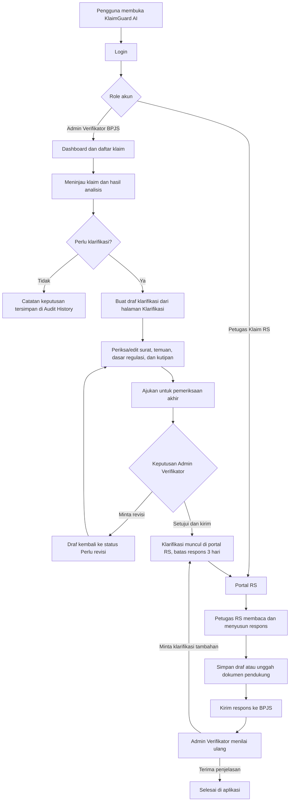

# Alur Aplikasi KlaimGuard AI

Dokumen ini menjelaskan alur aplikasi dari login sampai tindak lanjut klarifikasi klaim. Aplikasi saat ini memiliki **dua role**: **Admin Verifikator BPJS** dan **Petugas Klaim Rumah Sakit (RS/Faskes)**. Role Admin Audit sudah digabung ke Admin Verifikator.

## Ringkasan alur

## 1. Awal: login dan pemilihan ruang kerja

1. Pengguna membuka aplikasi dan login menggunakan akun yang diberikan untuk role-nya.
2. Sistem membaca role akun dan menampilkan ruang kerja yang sesuai.
3. Pengguna keluar melalui tombol **Keluar** untuk mengakhiri sesi dan kembali ke halaman login.

| Role | Ruang kerja yang ditampilkan |
| --- | --- |
| Admin Verifikator BPJS | Dashboard, Batch Analysis, Audit History, Manajemen Faskes, Klarifikasi, Reports, dan KlaimGuard Assistant |
| Petugas Klaim RS | Dashboard RS dengan daftar klarifikasi berpaginasi dan popup Profil Faskes |

## 2. Alur Admin Verifikator BPJS

### Meninjau klaim

1. Admin membuka **Dashboard** untuk melihat ringkasan klaim dan daftar klaim.
2. Admin mencari atau memfilter klaim, lalu membuka detail untuk meninjau data pendukung dan hasil analisis.
3. Analisis dapat menunjukkan klaim aman atau indikasi seperti upcoding dan unbundling. Hasil ini membantu telaah; keputusan tindak lanjut tetap dilakukan oleh petugas.
4. Untuk pemeriksaan banyak klaim, Admin dapat memakai **Batch Analysis**. Chatbot digunakan untuk bertanya tentang klaim dan regulasi; kutipan dokumen dapat ditampilkan jika tersedia.
5. Keputusan dan aktivitas verifikasi dapat dilihat di **Audit History**. **Reports** menyediakan ringkasan analitik dan ekspor PDF.

### Mengelola faskes

Admin membuka **Manajemen Faskes** untuk mendaftarkan faskes, membuat akun Petugas Klaim RS, dan mengaitkan klaim dengan faskes. Klaim perlu ditautkan ke faskes agar permintaan klarifikasi dapat dikirim ke portal penerima yang benar.

### Membuat dan menindaklanjuti klarifikasi

1. Admin membuka halaman **Klarifikasi** dan memilih **Susun Permintaan Klarifikasi**.
2. Admin memasukkan ID klaim dan memilih template surat. Sistem membuat draf berdasarkan temuan klaim dan dasar regulasi yang tersedia.
3. Admin meninjau serta mengedit isi surat, temuan, rekomendasi, dan kutipan regulasi. Perubahan isi surat disimpan sebagai versi.
4. Admin memilih **Ajukan verifikasi**. Status menjadi **Perlu pemeriksaan akhir**.
5. Karena role Admin Audit telah digabung, pemeriksaan akhir, persetujuan, atau permintaan revisi dilakukan oleh **Admin Verifikator BPJS** juga. Sistem mencatat aktor dan riwayat tindakannya; aplikasi tidak memisahkan persetujuan ke role auditor yang berbeda.
6. Jika revisi diminta, catatan revisi masuk ke diskusi. Admin memperbaiki draf lalu mengajukannya kembali.
7. Jika disetujui, klarifikasi dikirim ke portal faskes yang terhubung. Batas respons ditetapkan **3 hari**.
8. Setelah respons RS dikirim, Admin meninjau catatan dan dokumen pendukung. Admin dapat menerima penjelasan atau meminta klarifikasi tambahan.
9. Jika penjelasan diterima, status menjadi **Selesai di aplikasi**. Status ini menutup pencatatan di KlaimGuard AI dan bukan keputusan resmi atas klaim JKN.

## 3. Alur Petugas Klaim RS

1. Petugas login menggunakan akun yang dibuat untuk faskesnya.
2. **Dashboard RS** merangkum permintaan yang perlu direspons, menunggu penilaian BPJS, perlu perbaikan, selesai, dan mendekati tenggat. Data dapat dimuat ulang dengan tombol **Perbarui data** atau saat berpindah menu portal.
3. Petugas memilih item dari daftar dashboard untuk melihat detail klaim, temuan, regulasi, dokumen yang diminta, serta batas respons.
4. Petugas memilih jenis penjelasan, menulis catatan respons, dan bila perlu mengunggah dokumen pendukung **PDF atau JPG/JPEG**, maksimum **10 MB per file**.
5. Petugas dapat menyimpan respons sebagai draf untuk dilanjutkan kemudian, atau mengirimkannya ke BPJS.
6. Setelah dikirim, respons terkunci agar tidak berubah tanpa tindak lanjut baru.
7. Petugas memantau progres dan riwayat dari daftar serta detail klarifikasi di Dashboard. Riwayat aktivitas dalam detail tetap berpaginasi. Jika Admin meminta klarifikasi tambahan, Petugas mengisi respons versi berikutnya.
8. Profil faskes dapat dibuka dari ikon **Profil Faskes**.

## 4. Status klarifikasi yang perlu dikenali

| Status | Arti dalam alur |
| --- | --- |
| **Draf** | Draf sedang disusun atau diedit Admin Verifikator. |
| **Perlu pemeriksaan akhir** | Draf telah diajukan untuk disetujui atau diminta revisi oleh Admin Verifikator. |
| **Perlu revisi** | Draf dikembalikan dengan catatan; Admin dapat memperbaiki dan mengajukannya kembali. |
| **Terkirim / menunggu respons RS** | Klarifikasi sudah tersedia untuk faskes dan menunggu respons. |
| **Menunggu penilaian ulang** | RS sudah mengirim respons dan Admin Verifikator perlu menilainya. |
| **Selesai di aplikasi** | Admin menerima penjelasan dan pencatatan kasus ditutup di aplikasi. |

## 5. Ringkas pembagian tanggung jawab

| Aktivitas | Admin Verifikator BPJS | Petugas Klaim RS |
| --- | :---: | :---: |
| Melihat daftar klaim dan analitik | Ya | Tidak pada ruang kerja RS |
| Menjalankan analisis klaim/batch | Ya | Tidak |
| Bertanya pada chatbot regulasi | Ya | Tidak pada ruang kerja RS |
| Membuat dan mengedit draf klarifikasi | Ya | Tidak |
| Meminta revisi atau menyetujui dan mengirim klarifikasi | Ya | Tidak |
| Melihat permintaan yang ditujukan ke faskes | Ya | Ya, untuk faskes akun tersebut |
| Menulis dan mengirim respons RS | Tidak | Ya |
| Mengunggah dokumen pendukung respons | Tidak | Ya |
| Menilai respons atau meminta klarifikasi tambahan | Ya | Tidak |
| Melihat riwayat tindakan | Audit History verifikasi dan aktivitas RS | Riwayat klarifikasi dan aktivitas portal RS |

## Catatan alur

- Pembuatan permintaan klarifikasi dilakukan dari halaman **Klarifikasi**, bukan dari chatbot.
- Persetujuan akhir dan pengiriman ke RS saat ini dilakukan oleh role **Admin Verifikator BPJS** yang sama. Tidak ada role Admin Audit terpisah.
- Portal RS menampilkan permintaan yang terkait dengan faskes akun tersebut.
- Batas respons 3 hari dihitung sejak klarifikasi dikirim ke faskes.
- PDF klarifikasi dapat berisi surat, temuan, dasar regulasi, kutipan, respons RS, dan riwayat proses sesuai data yang tersedia.

## Referensi implementasi

- Ruang kerja dan akses role: `frontend/js/main.js`
- Alur draf, revisi, persetujuan, respons, dan PDF klarifikasi: `frontend/js/components/disputeWorkflow.js`
- Portal RS, unggah dokumen, respons, dan riwayat: `frontend/js/main.js`
- Validasi perubahan status klarifikasi: `backend/app/interfaces/api_disputes.py`
- Navigasi dua ruang kerja: `frontend/index.html`
